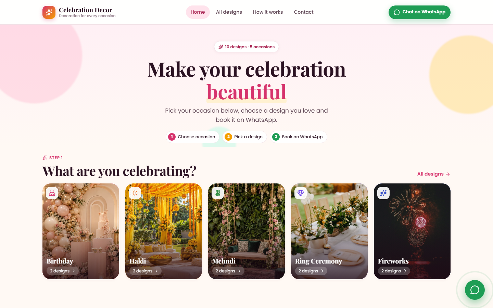
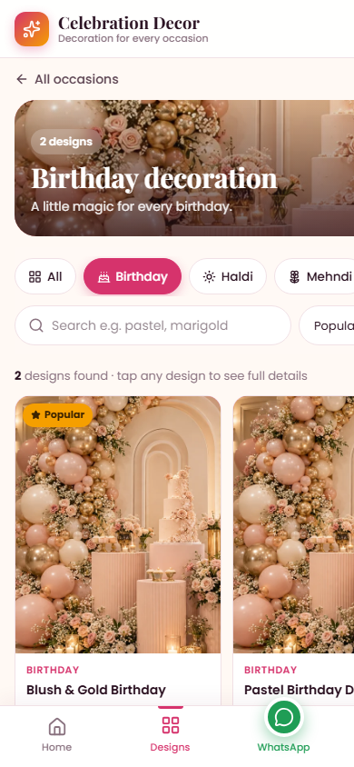
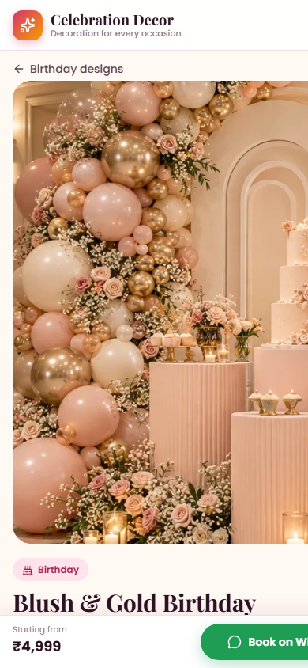
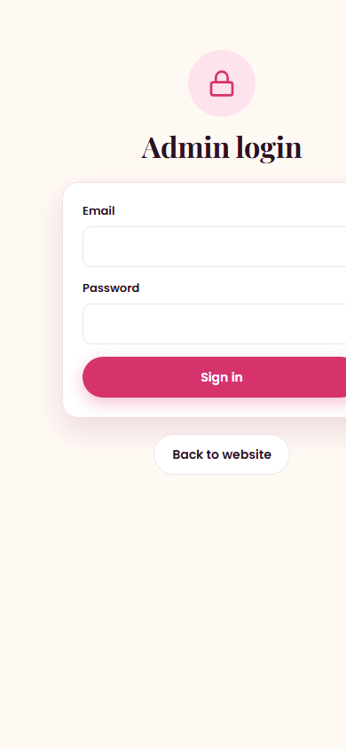

# Celebration Decor — Catalogue + Admin

Mobile-first event decoration catalogue with a built-in admin studio. Customers browse occasions → designs → details, then enquire on WhatsApp. Owners manage categories, designs, photos and business settings from `/admin`.

**Live demo:** [celebration-decor-demo.netlify.app](https://celebration-decor-demo.netlify.app)

---

## Screenshots

### Home (mobile)


### Home (desktop)



### Category → designs



### Design detail + WhatsApp booking



### Admin login



---

## Features

- Occasion categories on the home page (Birthday, Haldi, Mehndi, Ring Ceremony, Fireworks)
- Design list per category, with featured / price sorting
- Full design overview with gallery, inclusions, starting price
- Sticky WhatsApp enquiry button (pre-filled message)
- Admin studio: categories, decorations, media upload, testimonials, business settings
- Email + password admin login (no ChatGPT / Cloudflare Sites dependency)
- Free hosting on Netlify Free — data + photos stored in Netlify Blobs (no paid DB)

## Stack

| Layer | Choice |
| --- | --- |
| App | Next.js 16 (App Router) + React 19 + TypeScript |
| Styling | CSS (custom design tokens) + Tailwind utilities |
| Hosting | Netlify Free |
| Storage | Netlify Blobs (catalogue JSON + uploaded media) |
| Auth | Signed HttpOnly cookie session (`ADMIN_EMAIL` + `ADMIN_PASSWORD_HASH`) |

## Customer flow

1. Open site → pick an occasion  
2. Browse designs in that category  
3. Open a design → see price, inclusions, gallery  
4. Tap **Book on WhatsApp**

## Local development

Requirements: **Node.js 22.13+**, **pnpm 11**

```bash
pnpm install
pnpm hash-password "your-admin-password"
```

Create `.env.local` with the printed values:

```env
ADMIN_EMAIL=you@example.com
ADMIN_PASSWORD_HASH=scrypt:...
SESSION_SECRET=...
SITE_URL=http://localhost:5173
```

Then:

```bash
pnpm dev
```

- Website: http://localhost:5173  
- Admin: http://localhost:5173/admin  
- Local data is saved under `.data/` (git-ignored)

## Deploy to Netlify (free)

See [DEPLOY.md](./DEPLOY.md) for the full client hand-off steps.

Short version:

```bash
pnpm install
npx netlify-cli login
npx netlify-cli sites:create --name your-site-name
pnpm hash-password "client-password"
# set ADMIN_EMAIL, ADMIN_PASSWORD_HASH, SESSION_SECRET in Netlify env vars
npx netlify-cli deploy --build --prod
```

**Windows note:** if deploy fails with “Failed publishing static content”, copy the project to a folder that isn’t open in the editor (without `node_modules` / `.next` / `.env.local`), run `pnpm install` there, and deploy from that copy.

## Free plan limits

- Netlify Free: **300 credits / month**. Going over **pauses** sites on that account (no charge).
- Uploads capped at **~4.5 MB** per file (photos are compressed before upload). Prefer YouTube/Instagram links for long videos.
- For each paying client, use **their own** free Netlify account so one site’s traffic can’t pause another’s.

## Project structure

```
app/                 # pages + API routes
components/          # public catalogue + admin studio UI
lib/                 # auth, storage, catalog helpers, seed data
docs/screenshots/    # README screenshots
scripts/             # hash-password helper
netlify.toml         # Netlify build config
DEPLOY.md            # client deploy guide
```

## License

Private project — all rights reserved unless otherwise agreed with the author.
